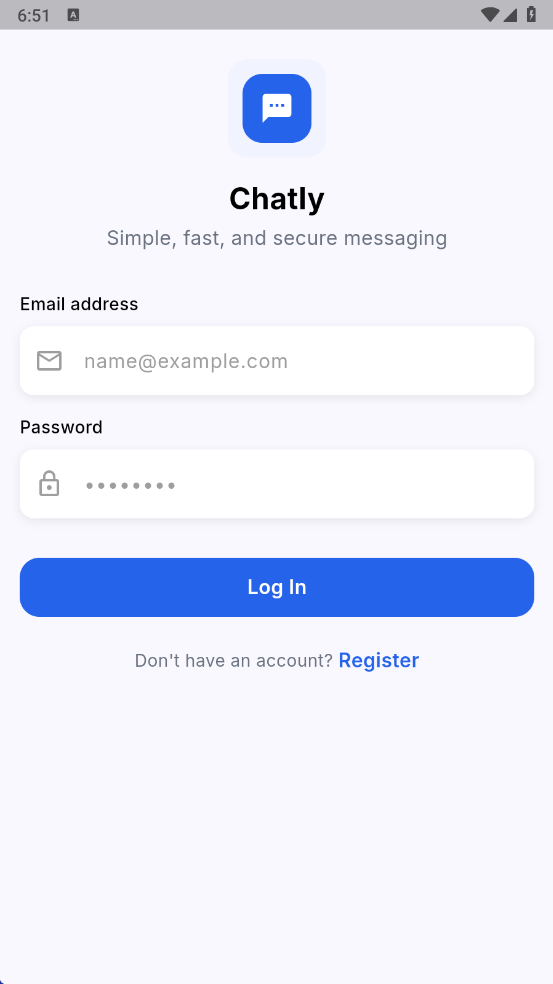
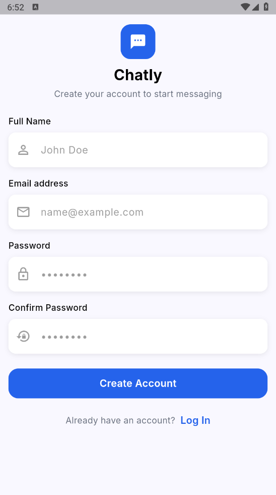
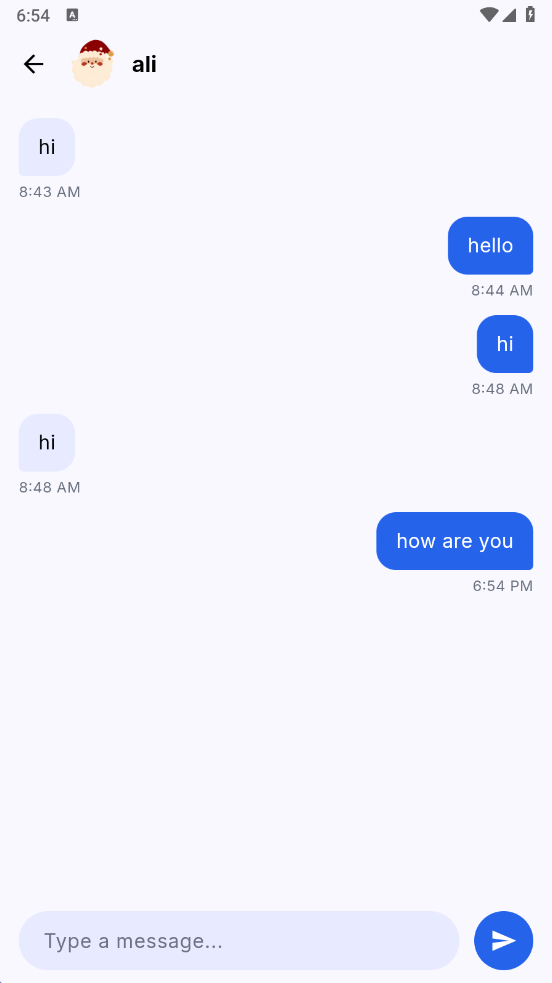

# chat app

A simple, fast real-time messaging app built with Flutter and Firebase.

## Screenshots

| Log In | Sign Up |
|--------|---------|
|  |  |

| Home | Chat |
|------|------|
|  |  |

## Features

- Sign up and log in with email and password
- Browse and search registered users
- One-to-one real-time chat

## Tech Stack

- Flutter (Dart)
- Firebase Authentication
- Cloud Firestore
- Provider (state management)

## Architecture

The project follows the MVVM pattern:

```
View → Provider (ViewModel) → Repository → Firebase Service
```

## Getting Started

1. Clone the repository:

```bash
git clone https://github.com/moaz-suliman/chat-app.git
cd chat-app-flutter
```

2. Install dependencies:

```bash
flutter pub get
```

3. Connect the project to your Firebase project:

```bash
dart pub global activate flutterfire_cli
flutterfire configure
```

4. In the Firebase Console, enable **Email/Password** in Authentication and create a **Firestore Database**.

5. Run the app:

```bash
flutter run
```
